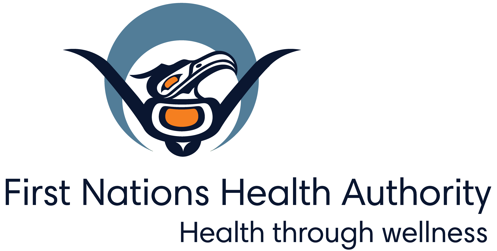
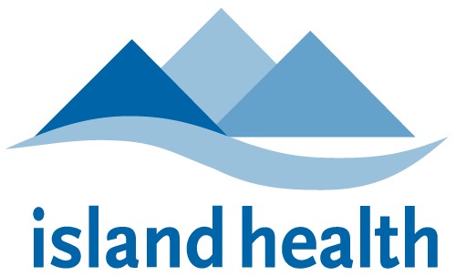

---
author:
- Nealan Gerrebos
authors:
- Nealan Gerrebos
burnRestrictions: 0
customMessage: Local air quality has improved due to changing
  meteorological conditions.
date: 2026-11-02
ice: End
location: Duncan
parametersAsRendered:
  aqMet: Nealan Gerrebos
  burnRestrictionArea: "`<location>`{=html}"
  burnRestrictionEndDate: 20760
  burnRestrictionEndTime: "HH:00 PM"
  burnRestrictionSDM: 1
  burnRestrictionStatus: 0
  customMessage: Local air quality has improved due to changing
    meteorological conditions.
  issuedate: 20758
  location: Duncan
  outputFormat: markdown
  pollutant: PM25
params:
  aqMet: Sakshi Jain
  burnRestrictionEndDate: 2025-09-28
  burnRestrictionEndTime: "12:00 PM"
  burnRestrictionSDM: Ben
  burnRestrictionStatus: 0
  issuedate: 2025-07-09
  location: Whistler
  outputFormat: markdown
  pollutant: PM25 & PM10
pollutant: PM25
title: Air quality warning ended for Duncan
toc-title: Table of contents
type: local_emissions
---

<!--
Copyright 2025 Province of British Columbia

This work is licensed under the Creative Commons Attribution 4.0 International License.
To view a copy of this license, visit http://creativecommons.org/licenses/by/4.0/.
-->
<!-- Logo header, the layout-col should be set based on number of logos including FHNA and BCGov -->
<!-- the trailing slash means the text in square brackets is alt text -->

::: {layout-ncol= 3 layout-valign="bottom"}

\

\

\

:::

The Ministry of Environment and Parks in collaboration with the
Vancouver Island Health Authority has ended the Air Quality Warning that
was issued on November 01, 2026 for Duncan due to elevated levels of
fine particulate matter.

Local air quality has improved due to changing meteorological
conditions.

## More information



The provincial air quality objective for PM~2.5~ is 25 micrograms per
cubic metre (μg/m^3^) averaged over 24 hours. 24-hour average PM~2.5~
concentrations are summarized below for Duncan and nearest monitored
communities at 8:00 AM local time today:

::: {.table-responsive}

  --------------------------------------------------------------------------------
  Community                Duncan   Courtenay   Nanaimo   Port Alberni  Victoria
  ------------------------ -------- ----------- --------- ------------- ----------
  24-hr average (μg/m^3^)  20.8     13.9        10.3      14.1          9.5

  --------------------------------------------------------------------------------

:::

Visit the provincial [air quality data
webpage](https://www2.gov.bc.ca/gov/content/environment/air-land-water/air/air-quality)
for real-time observations.



## Contact

**Media questions regarding this Air Quality Warning:**


Nealan Gerrebos` `{=html}Air Quality
Meteorologist` `{=html}Ministry of Environment and
Parks` `{=html}778-788-3787



**Media questions regarding health implications when air quality is
degraded:** 

Vancouver Island Health Authority` `{=html}Dominic Abassi:
250-755-7966 (Dominic.abassi@viha.ca)` `{=html}Andrew Leyne:
250-370-8908 (Andrew.leyne@viha.ca)` `{=html}After-hours media
line: 250-716-7750` `{=html}


