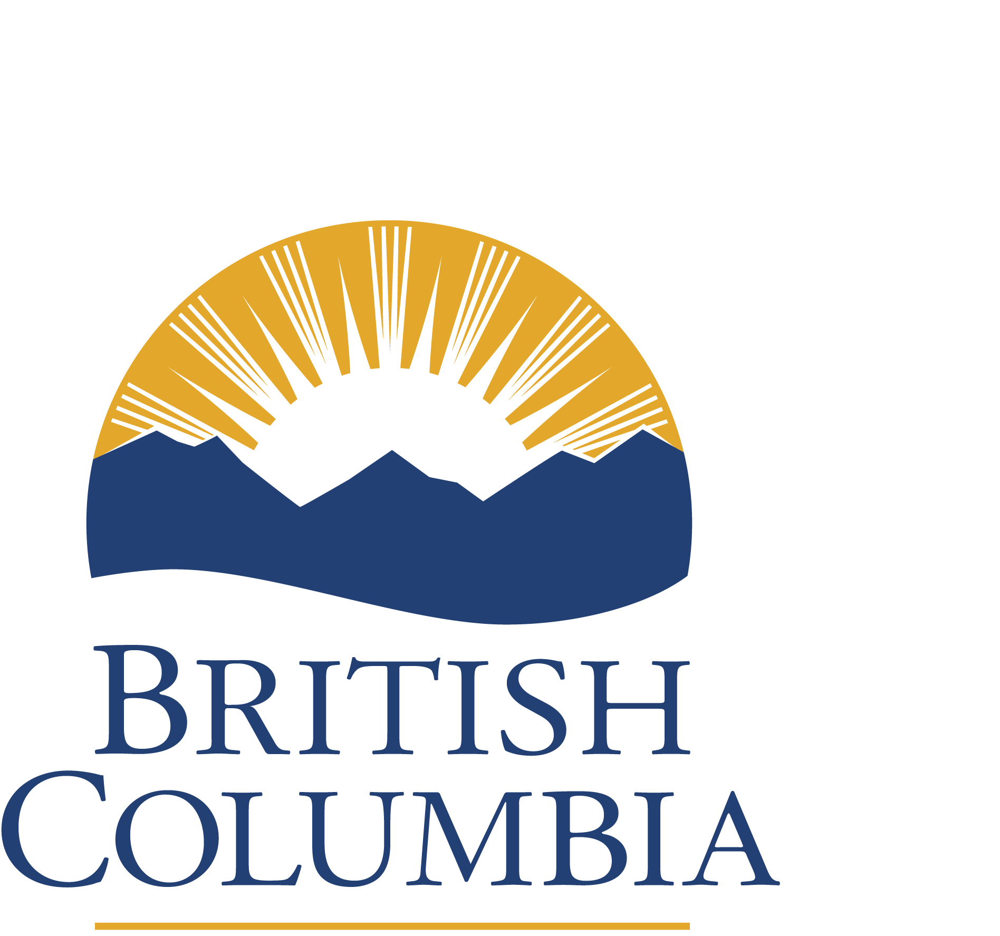
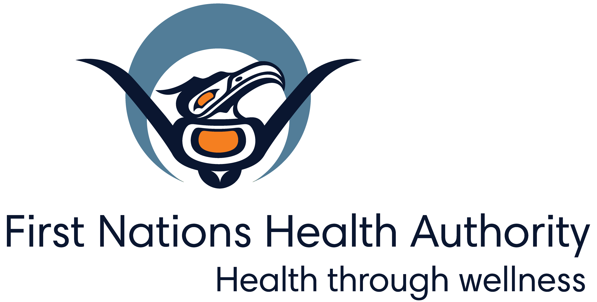

---
author:
- Nealan Gerrebos
authors:
- Nealan Gerrebos
burnRestrictions: 2
customMessage: Local air quality has improved due to changing
  meteorological conditions and/or decreased local emissions. An open
  burning prohibition remains in effect to allow air quality to fully
  recover.
date: 2026-11-06
ice: End
location: Golden
parametersAsRendered:
  aqMet: Nealan Gerrebos
  burnRestrictionArea: Golden and Invermere Timber Supply Areas
  burnRestrictionEndDate: 20764
  burnRestrictionEndTime: "4:00 PM"
  burnRestrictionSDM: 1
  burnRestrictionStatus: 2
  customMessage: Local air quality has improved due to changing
    meteorological conditions and/or decreased local emissions. An open
    burning prohibition remains in effect to allow air quality to fully
    recover.
  issuedate: 20762
  location: Golden
  outputFormat: markdown
  pollutant: PM25
params:
  aqMet: Sakshi Jain
  burnRestrictionEndDate: 2025-09-28
  burnRestrictionEndTime: "12:00 PM"
  burnRestrictionSDM: Ben
  burnRestrictionStatus: 0
  issuedate: 2025-07-09
  location: Whistler
  outputFormat: markdown
  pollutant: PM25 & PM10
pollutant: PM25
title: Air quality warning ended for Golden - open burning restrictions
  remain in effect
toc-title: Table of contents
type: local_emissions
---

<!--
Copyright 2025 Province of British Columbia

This work is licensed under the Creative Commons Attribution 4.0 International License.
To view a copy of this license, visit http://creativecommons.org/licenses/by/4.0/.
-->
<!-- Logo header, the layout-col should be set based on number of logos including FHNA and BCGov -->
<!-- the trailing slash means the text in square brackets is alt text -->

::: {layout-ncol= 3 layout-valign="bottom"}

\

\

\

:::

The Ministry of Environment and Parks in collaboration with the Interior
Health Authority has ended the Air Quality Warning that was issued on
November 05, 2026 for Golden due to elevated levels of fine particulate
matter.

Local air quality has improved due to changing meteorological conditions
and/or decreased local emissions.

Open burning restrictions remain in effect within Golden and Invermere
Timber Supply Areas. No new fires may be initiated, and no additional
material may be added to existing fires. For more information on burning
restrictions, refer to the Mandatory Emission Reduction Actions section
below.

## Mandatory emission reduction actions

NOTICE of DIRECTOR under s.30 Open Burning Smoke Control Regulation:

As pollution is occurring or is likely to occur from open burning,
pursuant to Sections 30(1) and 30(2) of the Open Burning Smoke Control
Regulation, the Director has prohibited open burning within Golden and
Invermere Timber Supply Areas until November 07, 2026 4:00 PM local
time. No vegetative debris may be ignited or added to ignited piles.
Contravention of these provisions may be subject to a fine under the
Regulation.

Date issued: November 06, 2026` `{=html}Benjamin
Weinstein` `{=html}For Director, Environmental Management
Act` `{=html}Environmental Monitoring and Analysis Branch

## More information



The provincial air quality objective for PM~2.5~ is 25 micrograms per
cubic metre (μg/m^3^) averaged over 24 hours. 24-hour average PM~2.5~
concentrations are summarized below for Golden and nearest monitored
communities at 10:00 AM local time today:

::: {.table-responsive}

  -------------------------------------------------------------------------------
  Community                 Golden   Castlegar   Cranbrook   Elkford   Sparwood
  ------------------------- -------- ----------- ----------- --------- ----------
  24-hr average (μg/m^3^)   14.1     21.3        10.8        7.9       7.4

  -------------------------------------------------------------------------------

:::

Visit the provincial [air quality data
webpage](https://www2.gov.bc.ca/gov/content/environment/air-land-water/air/air-quality)
for real-time observations.



## Contact

**Media questions regarding this Air Quality Warning:**


Nealan Gerrebos` `{=html}Air Quality
Meteorologist` `{=html}Ministry of Environment and
Parks` `{=html}236-468-2247



**Media questions regarding health implications when air quality is
degraded:** 

Interior Health Authority` `{=html}Media line:
1-844-469-7077` `{=html}Email:
media@interiorhealth.ca` `{=html}


