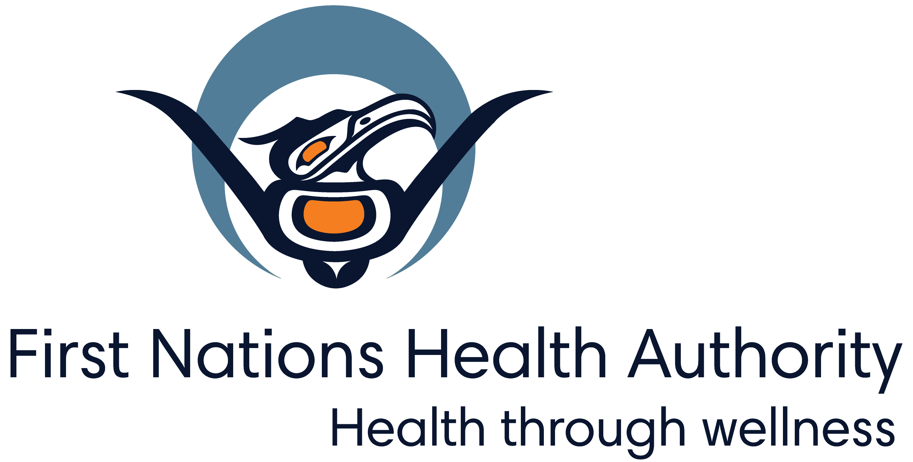

---
author:
- Jill Psotka
authors:
- Jill Psotka
burnRestrictions: 0
customMessage: Local air quality has improved.
date: 2026-11-19
ice: End
location: Vanderhoof
parametersAsRendered:
  aqMet: Jill Psotka
  burnRestrictionArea: "`<location>`{=html}"
  burnRestrictionEndDate: 20777
  burnRestrictionEndTime: "HH:00 PM"
  burnRestrictionSDM: 1
  burnRestrictionStatus: 0
  customMessage: Local air quality has improved.
  issuedate: 20775
  location: Vanderhoof
  outputFormat: markdown
  pollutant: PM10
params:
  aqMet: Sakshi Jain
  burnRestrictionEndDate: 2025-09-28
  burnRestrictionEndTime: "12:00 PM"
  burnRestrictionSDM: Ben
  burnRestrictionStatus: 0
  issuedate: 2025-07-09
  location: Whistler
  outputFormat: markdown
  pollutant: PM25 & PM10
pollutant: PM10
title: Air quality warning ended for Vanderhoof
toc-title: Table of contents
type: local_emissions
---

<!--
Copyright 2025 Province of British Columbia

This work is licensed under the Creative Commons Attribution 4.0 International License.
To view a copy of this license, visit http://creativecommons.org/licenses/by/4.0/.
-->
<!-- Logo header, the layout-col should be set based on number of logos including FHNA and BCGov -->
<!-- the trailing slash means the text in square brackets is alt text -->

::: {layout-ncol= 3 layout-valign="bottom"}

\

\

\

:::

The Ministry of Environment and Parks in collaboration with the Northern
Health Authority has ended the Air Quality Warning that was issued on
November 18, 2026 for Vanderhoof due to elevated levels of coarse
particulate matter.

Local air quality has improved.

## More information



The provincial air quality objective for PM~10~ is 50 micrograms per
cubic metre (μg/m^3^), averaged over 24 hours. 24-hour average PM~10~
concentrations are summarized below for Vanderhoof and nearest monitored
communities at 8:00 AM local time today:

::: {.table-responsive}

  ---------------------------------------------------------------------------
  Community                 Vanderhoof   Burns Lake  Houston   Prince George
  ------------------------- ------------ ----------- --------- --------------
  24-hr average (μg/m^3^)   14.3         NA          37.3      15.6

  ---------------------------------------------------------------------------

:::

Visit the provincial [air quality data
webpage](https://www2.gov.bc.ca/gov/content/environment/air-land-water/air/air-quality)
for real-time observations.



## Contact

**Media questions regarding this Air Quality Warning:**


Jill Psotka` `{=html}Air Quality
Meteorologist` `{=html}Ministry of Environment and
Parks` `{=html}236-468-3521



**Media questions regarding health implications when air quality is
degraded:** 

Northern Health Authority` `{=html}Media Line:
1-877-961-7724` `{=html}


